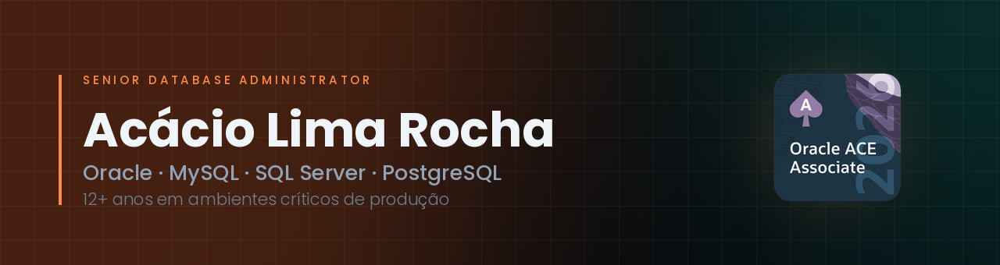

  
  
  
  

---

### Senior Database Administrator · 12+ years in mission-critical production

I keep databases alive where downtime has a price tag. Oracle, MySQL, SQL Server and
PostgreSQL — high availability, disaster recovery, performance tuning and the kind of
troubleshooting that happens at 3 a.m. **Oracle ACE Associate**, 14 Oracle credentials,
and a habit of turning what I learn into open-source tooling. I also co-founded
[DBA BRABO](https://dbabrabo.com.br), a technical mentorship program for DBAs in Brazil.

---

## Sobre

Sou DBA há mais de 12 anos, sempre em ambientes onde parada custa caro. Meu trabalho
mora na parte chata e crítica do banco: alta disponibilidade, contingência, recuperação
de desastre, tuning e o troubleshooting que ninguém quer receber de madrugada.

Passei por **Principal Advanced Support Engineer**, **MySQL Tech Lead** e **Consultor DBA
Sênior**. Sou **Oracle ACE Associate** e **LinkedIn Top Database Administration Voice 2024**.

O que eu aprendo apanhando em produção eu transformo em duas coisas: **ferramenta open
source** e **mentoria**. Estão as duas aqui embaixo.

---

## Credenciais

<!-- Para transformar cada medalha em link de verificacao do Credly, envolva a tag 
     assim:  
     Os IDs saem do seu perfil do Credly, em cada badge, no botao "Share > Link". -->

<table>
  <tr>
    <td align="center" width="33%">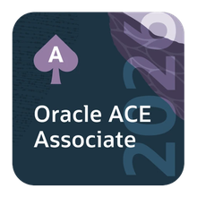 <b>Oracle ACE Associate</b> Reconhecimento</td>
    <td align="center" width="33%">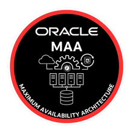 <b>Oracle MAA</b> Maximum Availability Architecture</td>
    <td align="center" width="33%">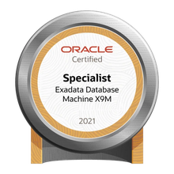 <b>Exadata X9M</b> Specialist</td>
  </tr>
</table>

**Professional** — o nível mais alto das provas de certificação Oracle

<table>
  <tr>
    <td align="center" width="20%">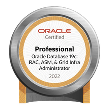 19c RAC, ASM e Grid Infrastructure</td>
    <td align="center" width="20%"> 19c Data Guard</td>
    <td align="center" width="20%">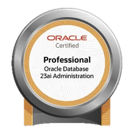 23ai Administration</td>
    <td align="center" width="20%">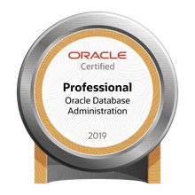 Database Administration</td>
    <td align="center" width="20%">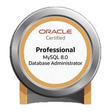 MySQL 8.0 Administrator</td>
  </tr>
</table>

**Associate** · **Foundations**

<table>
  <tr>
    <td align="center" width="16%">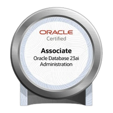 23ai Administration</td>
    <td align="center" width="16%">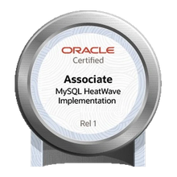 MySQL HeatWave Implementation</td>
    <td align="center" width="16%">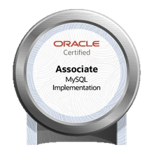 MySQL Implementation</td>
    <td align="center" width="16%">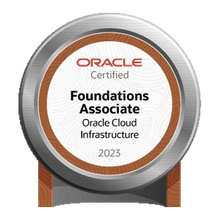 Oracle Cloud Infrastructure</td>
    <td align="center" width="16%">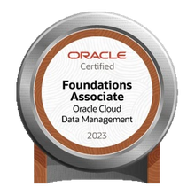 Cloud Data Management</td>
    <td align="center" width="16%"> OCI AI Foundations</td>
  </tr>
</table>

---

## Projetos

Tudo roda no terminal, por SSH, sem agente e sem servidor web para expor.

### Monitoração no terminal

#### [ORA BRABO](https://github.com/acaciolr/ora-brabo) · `em produção`

Monitoramento Oracle direto no terminal, construído em Textual. 12 painéis acessíveis por
teclas de função, cobrindo RAC, Data Guard, ASM e Exadata. Os coletores são assíncronos —
a interface não trava esperando query voltar.

#### [SQL BRABO](https://github.com/acaciolr/sql-brabo) · `em produção`

O ORA BRABO para SQL Server — o Activity Monitor que você acessa por SSH. Sessões, Top SQL,
waits, bloqueios, Always On, log shipping, backups, TempDB e um Advisor com regras
automáticas, tudo lido de DMVs, de SQL Server 2012 a 2025, em Windows ou Linux.

#### [PG BRABO](https://github.com/acaciolr/pg_brabo) · `em produção`

*The pgAdmin you SSH into.* Cockpit PostgreSQL no terminal: monitoramento, performance,
backup/recovery, replicação, HA e segurança.

### Diagnóstico, segurança e operação

#### [ORACLE RECOVERY BRABO](https://github.com/acaciolr/oracle-recovery-database-framework) · `em produção`

Orquestrador de backup, restore e recovery Oracle para Unix, guiado pelo princípio
**descobrir → validar → planejar → mostrar comandos → mostrar riscos** antes de executar
qualquer coisa. Shell POSIX (`ksh`/`sh`), 14 áreas.

#### [MyBraboSat](https://github.com/acaciolr/mybrabosat) · `em produção`

Security assessment de MySQL em um único arquivo `.sql`, somente leitura: 53 verificações
em contas, privilégios, rede e criptografia, configuração, auditoria e dados pessoais (LGPD),
cada falha com o comando de correção e a nota de postura de 0 a 100. Sai em HTML
autocontido, em PDF pelo próprio relatório e em texto para ler no terminal.

#### [BSAR — BRABO Slow Analyze Report](https://github.com/acaciolr/bsar) · `em produção`

Analisador de slow query log do MySQL, MariaDB e Percona no estilo AWR: lê do arquivo ou da
`mysql.slow_log`, normaliza e agrega por fingerprint, compara períodos com snapshots em
SQLite e entrega o relatório no terminal e em HTML interativo, com JSON e CSV. Modo watch
com alertas e EXPLAIN das piores queries. Zero dependências externas.

#### [MySQL Export Users](https://github.com/acaciolr/dbabrabo_mysqlexportusers) · `em produção`

Extensão nativa do **MySQL Shell** que exporta usuários, roles e privilégios em SQL
idempotente, gera `REVOKE`s para rollback e auditoria e converte sintaxe MariaDB → MySQL.
Pronto para Git e para replay entre ambientes.

### Laboratórios Super DBA

Uma plataforma de laboratório por tecnologia, construída para a mentoria
[DBA BRABO](https://github.com/DBA-BRABO): instala com um comando, sobe os nós e abre um
menu em que cada opção executa operação real sobre o banco — e termina com `PASS` ou `FAIL`.

| Laboratório | Estado | O que cobre |
| --- | --- | --- |
| **SQL Server Super DBA** | `testado em ambiente real` | SQL Server 2022/2025 em Linux: Always On com Pacemaker + listener, log shipping, replicação, PITR, TDE/TLS, IA no 2025 |
| **PostgreSQL Super DBA** | `em homologação` | replicação, HA, backup/PITR, upgrade, pooling, pgvector, chaos — 112 tópicos executáveis |
| **MySQL Super DBA** | `em homologação` | 19 topologias: InnoDB Cluster, Group Replication, NDB, Percona XtraDB Cluster, caos e recuperação |
| **Oracle Super DBA** | `em desenvolvimento` | VMs Oracle Linux reais: RAC com ASM, Data Guard, Exadata e ZDLRA |
| **MongoDB Super DBA** | `em desenvolvimento` | replica set e sharding |

Os laboratórios são privados: o acesso é liberado para os mentorados da DBA BRABO.

---

## Stack

---

## DBA BRABO

Mentoria técnica para DBAs que fundei com Luis Macedo e Weverton Amorim. Não é curso gravado: é acompanhamento em
cima de ambiente real, com trilha por tecnologia — Oracle, MySQL, SQL Server, PostgreSQL,
MongoDB, GoldenGate, Exadata, ODA, ZDLRA e as três nuvens.

**[dbabrabo.com.br](https://dbabrabo.com.br)** · [LinkedIn](https://www.linkedin.com/company/dbabrabo) · [@dbabrabo](https://instagram.com/dbabrabo)

---

  
  

Se o banco caiu e ninguém sabe por quê, é sobre isso que eu converso melhor.

